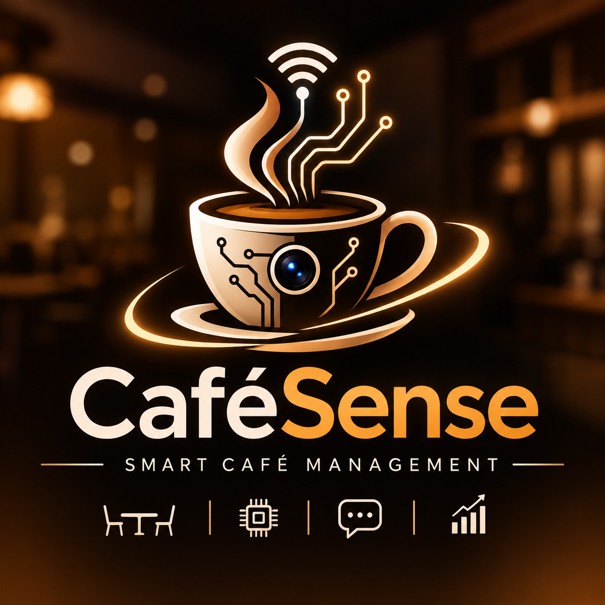

<p align="center">
  
</p>

<h1 align="center">CaféSense — Smart Café IoT & Agent Conversationnel IA</h1>

<p align="center">
  <strong>Système Autonome de Restauration Intelligente & IoT Analytics</strong><br>
  <em>Déployé pour le café-restaurant « Coffee House Lac » (Tunis, Tunisie)</em>
</p>

<p align="center">
  
  
  
  
  
  
  
</p>

---

## 📑 Sommaire

1. [Vue d'Ensemble du Projet](#-vue-densemble-du-projet)
2. [Points Forts & Valeur Ajoutée de l'IA](#-points-forts--valeur-ajoutée-de-lia)
3. [Architecture de l'Intelligence Artificielle](#-architecture-de-lintelligence-artificielle)
   - [Module 1 : Vision par Ordinateur IoT (YOLOv8n & Géométrie Spatiale)](#1-module-1--vision-par-ordinateur-iot-yolov8n--géométrie-spatiale)
   - [Module 2 : Agent Conversationnel Hybride (Qwen2.5-1.5B LoRA + RAG Déterministe)](#2-module-2--agent-conversationnel-hybride-qwen25-15b-lora--rag-déterministe)
4. [Architecture Logicielle Globale (Clean Architecture)](#-architecture-logicielle-globale-clean-architecture)
5. [Interface Utilisateur (Angular 21 Reactive Signals)](#-interface-utilisateur-angular-21-reactive-signals)
6. [Arborescence Détaillée du Répertoire](#-arborescence-détaillée-du-répertoire)
7. [Installation & Démarrage en 1 Clic](#-installation--démarrage-en-1-clic)
8. [Catalogue des Endpoints REST & Flux Vidéo](#-catalogue-des-endpoints-rest--flux-vidéo)
9. [Tableau Comparatif & Performances](#-tableau-comparatif--performances)

---

## 🎨 Identité Visuelle (Palette CaféSense)

| Couleur | Hex | Usage dans l'application |
| :--- | :--- | :--- |
| ⬜ Blanc | `#FFFFFF` | Titres, texte actif |
| 🤎 Crème | `#EAD7C3` | Texte principal, reflets |
| 🟧 Ambre | `#F2A341` | Accent principal, boutons, chronomètres, KPI |
| 🌸 Rose corail | `#E25970` | Accent secondaire, dégradés, état « en départ » |
| 🟫 Caramel | `#B35E1B` | Dégradés, bulles utilisateur |
| ☕ Moka | `#382516` | Cartes en verre (glassmorphism) |
| ⬛ Espresso | `#0D0805` | Fond de l'application |

---

## 🌟 Vue d'Ensemble du Projet

Le projet **Smart Café** est une solution complète combinant l'**Internet des Objets (IoT)**, la **Vision par Ordinateur temps réel** et le **Traitement Automatique du Langage Naturel (NLP)**. Conçu spécifiquement pour le secteur de la restauration et de l'hospitalité moderne, il répond à deux défis opérationnels majeurs :

1. **Surveillance Automatisée de l'Occupation des Tables** :
   * Remplacement des capteurs physiques encombrants et coûteux (infrarouge, ultrasons, poids) par une **analyse vidéo non intrusive** via webcam ou caméras de vidéosurveillance standard.
   * Détection en temps réel des tables et des clients, avec suivi d'état dynamique (🟢 **LIBRE**, 🔴 **OCCUPÉE**, 🟠 **EN DÉPART** / Délai de grâce) et chronométrage précis du temps de présence.
2. **Expérience Client Autonome & Hyper-Personnalisée** :
   * Un **Agent IA conversationnel** bilingue (Français et Dialecte Tunisien / *Derja*) capable d'orienter les clients sur la carte du restaurant (68 articles, formules combinées, allergènes, prix en Dinars Tunisiens).
   * **Connexion directe avec la vision IoT** : l'agent informe instantanément les clients du nombre de tables libres réelles en interrogeant l'état en direct des caméras.

> 🔒 **Contrainte Académique & Éthique Majeure :**  
> **100% Open-Source et Indépendant.** Le projet ne fait appel à **aucune API commerciale externe payante** (aucun appel à OpenAI GPT-4, Anthropic Claude ou Google Gemini). Tous les modèles ont été entraînés, adaptés via *Fine-Tuning* et s'exécutent en local.

---

## 🚀 Points Forts & Valeur Ajoutée de l'IA

* 🎯 **Double IA Spécialisée par Fine-Tuning** :
  * Un réseau convolutif ultra-rapide (**YOLOv8n**) adapté à la géométrie spécifique des cafés.
  * Un grand modèle de langage compact (**Qwen2.5-1.5B**) adapté par **LoRA (Low-Rank Adaptation)** pour capturer le vocabulaire de restauration et le dialecte tunisien.
* 📐 **Résolution Spatiale Hybride & Anti-Faux Positifs** :
  * Algorithme géométrique strict bord-à-bord (≤ 30 px) éliminant les faux appariements entre tables et clients distants (clients au bar, musiciens de fond).
  * Filtrage anti-passants (temporisation de 3 secondes) et exclusion automatique des étiquettes OSD (*"CAM 1"*).
* 🔄 **Architecture Hybride Déterministe (RAG + Tool Calling)** :
  * Éradication totale des hallucinations de prix ou d'allergènes grâce à un moteur local pondéré couplé au LLM.
* 🎥 **Bascule Multi-Sources Fluide & DirectShow** :
  * Sélection dynamique en direct entre 4 sources (Webcam PC `0` et 3 caméras de surveillance `CAM1.mp4`, `CAM2.mp4`, `CAM3.mp4`) avec initialisation ultra-rapide (< 150 ms) sous Windows.
* ⚡ **Frontend Angular 21 à Haute Réactivité** :
  * Utilisation exclusive des **Signals Angular** pour une mise à jour d'interface chirurgicale et fluide sans surcoût de détection de cycle.

---

## 🧠 Architecture de l'Intelligence Artificielle

```
                                    ┌──────────────────────────────────────────────┐
                                    │    Sources Vidéo (Webcam PC / CAM 1, 2, 3)   │
                                    └──────────────────────┬───────────────────────┘
                                                           │ Flux BGR (640x480 / 30 FPS)
                                                           ▼
┌─────────────────────────────────┐              ┌───────────────────────────────────┐
│     Client Web Angular 21       │              │      Module Vision (YOLOv8n)      │
│  - Flux MJPEG en Direct         │◄─────────────┤  - Détection tables & personnes   │
│  - Dashboard KPI réactif        │              │  - Filtrage géométrique strict    │
│  - Sélecteur 4 Caméras          │              │  - Machine à états & chronomètres │
│  - Chatbot IA Conversationnel   │              └─────────────────┬─────────────────┘
└────────────────┬────────────────┘                                │
                 │                                                 │ État JSON des Tables
                 │ Question Client                                 ▼
                 ▼                               ┌───────────────────────────────────┐
┌─────────────────────────────────┐              │     Agent IA Hybride (Cerveau)    │
│      Backend Flask (API)        ├─────────────►│  - LLM Qwen2.5-1.5B (Adaptateur)  │
│    (Clean Architecture)         │              │  - Moteur RAG Menu (68 articles)  │
│  - Repositories, Domain, Core   │◄─────────────┤  - Passerelle Vision temps réel   │
└─────────────────────────────────┘  Réponse     └───────────────────────────────────┘
```

---

### 1. Module 1 : Vision par Ordinateur IoT (YOLOv8n & Géométrie Spatiale)

#### A. Choix du Modèle de Base
Le modèle retenu est **YOLOv8n (Nano)** de chez Ultralytics :
* **Nombre de paramètres** : 3 132 950 (~3.2M), pour un poids plume de seulement **6.2 Mo**.
* **Structure** : Backbone CSPDarknet53 avec blocs C2f, couplé à un Neck PANet et une tête *anchor-free*.
* **Raison du choix** : Vitesse d'inférence exceptionnelle sur CPU classique (compatible embarqué / Raspberry Pi), garantissant un traitement en temps réel sans latence.

#### B. Pipeline d'Entraînement sous Google Colab (Tesla T4)
* **Dataset & Pseudo-Labelling** :
  * Extraction de **1 384 images** à intervalle régulier (1 image toutes les 2 secondes) à partir d'une vidéo de surveillance de 61.5 minutes (`cafe.mp4`).
  * Annotation automatique (*Teacher-Student architecture*) via le modèle enseignant `yolo11x.pt` pré-entraîné sur COCO, couplé à des filtres géométriques rigoureux (élimination des faux positifs sur le parquet ciré et les reflets de lampes).
  * Répartition chronologique : **80% Train (1 107 images)** et **20% Validation (277 images)**.
* **Hyperparamètres d'entraînement** :
  * Optimiseur : **AdamW** automatique (`lr = 0.001667`).
  * Précision mixte : **AMP (Automatic Mixed Precision - FP16)** activée.
  * Résolution : 640 × 640 pixels, batch de 16, arrêt anticipé (*early stopping*) avec `patience=12`.
  * Augmentations : Mosaïque (1.0), variations HSV, retournement horizontal (`fliplr=0.5`), et désactivation stricte du retournement vertical (`flipud=0.0`).
* **Performances atteintes** :
  * Époques : 44 époques (meilleur checkpoint à l'époque 32).
  * **mAP50 Global : 98.9%** | **mAP50-95 Global : 93.7%**
  * Précision tables : **99.5%** | Rappel tables : **99.8%**

#### C. Algorithme de Décision Spatiale & Filtrage (`CafeMonitorV2`)
Détecter des boîtes englobantes ne suffit pas à déterminer si une table est occupée. Le composant `CafeMonitorV2` intègre des filtres mathématiques avancés :

##### 1. Distance bord-à-bord stricte

Pour éviter d'associer des clients assis au bar ou en arrière-plan à des tables libres centrales, la distance minimale entre la table (x1, y1, x2, y2) et la personne (px1, py1, px2, py2) est calculée ainsi :

```math
dx = \max(0,\ x_1 - px_2,\ px_1 - x_2) \qquad dy = \max(0,\ y_1 - py_2,\ py_1 - y_2)
```

```math
d_{edge} = \sqrt{dx^2 + dy^2}
```

L'association n'est autorisée que si :

```math
d_{edge} \le d_{allowed} = \min\left(30,\ \max(12,\ 0.18 \cdot w_{table})\right)
```

*(Une personne située au comptoir à 113.7 px ou un musicien à 236 px est immédiatement rejeté, la table restant LIBRE.)*

##### 2. Zone d'assise rapprochée

Les marges d'extension de la table vers les chaises sont limitées à +15 % (max 25 px) :

```math
Zone_{chaise} = \left[\, x_1 - 0.15\,w,\ \ y_1 - 0.15\,h,\ \ x_2 + 0.15\,w,\ \ y_2 + 0.25\,h \,\right]
```

##### 3. Filtrage anti-watermark OSD

Rejet systématique des boîtes détectées sur l'incrustation vidéo du coin inférieur droit (x2 ≥ W − 20 et y2 ≥ H − 20), pour éviter que le logo *"CAM 1"* ne soit pris pour une table.

4. **Machine à États Temporelle** :
   ```
   [Table Détectée] ──► 🟢 LIBRE
                           │
                           │ Client présent en continu >= 3.0 s (Anti-passant)
                           ▼
                       🔴 OCCUPÉE (Démarrage Chronomètre)
                           │
                           │ Absence du client >= 2.5 s
                           ▼
                       🟠 EN DÉPART (Délai de grâce 25 s)
                           │
                           ├── Client revient ──► 🔴 OCCUPÉE
                           │
                           └── Délai écoulé   ──► 🟢 LIBRE (Chronomètre réinitialisé)
   ```

#### D. Export Multi-Plateforme (ONNX & NCNN)
Le modèle PyTorch `best.pt` a été converti en graphe statique optimisé **ONNX** (`best.onnx`) avec simplification d'opérateurs (`simplify=True`). Il permet une inférence ultra-légère via **ONNX Runtime** sur tout processeur x86 ou ARM (Raspberry Pi) sans nécessiter la suite PyTorch complète.

---

### 2. Module 2 : Agent Conversationnel Hybride (Qwen2.5-1.5B LoRA + RAG Déterministe)

#### A. Le Modèle de Base
* **Modèle** : `Qwen/Qwen2.5-1.5B-Instruct` (Alibaba Cloud).
* **Architecture** : Transformer auto-régressif causal de **1.56 milliard de paramètres**.
* **Capacités** : Compréhension contextuelle poussée, multilinguisme natif et suivi fidèle des consignes de conversation.

#### B. Spécialisation par Fine-Tuning LoRA (PEFT)
Pour adapter l'agent au ton et au contexte du café sans modifier les 1.5 milliard de poids de base, nous avons employé la technique **LoRA (Low-Rank Adaptation)** :
* **Décomposition de rang** : `W = W0 + (α/r)·(B·A)` avec r = 16 et α = 32.
* **Couches ciblées** : 7 modules de projection (`q_proj`, `k_proj`, `v_proj`, `o_proj`, `gate_proj`, `up_proj`, `down_proj`).
* **Poids entraînés** : **18 464 768 paramètres** seulement (**1.18%** de l'ensemble du réseau).
* **Empreinte de l'adaptateur** : Seulement **73.9 Mo** (contre 3.09 Go pour le modèle de base).
* **Entraînement** : Google Colab GPU T4, en précision FP16, batch effectif de 8 (batch 2 × accumulation 4), learning rate 2e-4 avec AdamW.

#### C. Moteur Hybride & RAG Déterministe (`menu_engine.py`)
> 💡 **Pourquoi une architecture hybride est indispensable :**  
> Les LLM de petite taille peuvent halluciner des faits précis (confondre un prix à 2.8 DT avec 1.5 DT, ou inventer un ingrédient). Pour garantir une exactitude factuelle à 100%, le système sépare la **compréhension du langage** de la **source de vérité**.

Le moteur de connaissances local applique une pipeline en 4 temps :

```
[Question Utilisateur]
       │
       ▼
1. Nettoyeur Phonétique & Typographique (ex: "jut" -> "jus", "desponible" -> "disponible")
       │
       ├── Détection "Disponibilité Tables" ──► 2. Interrogation VisionService en Direct
       │                                           (Retourne tables libres réelles)
       │
       └── Détection "Menu & Produits" ───────► 3. Recherche Pondérée (Base JSON)
                                                   - Score Nom exact : +100
                                                   - Score Alias : +80
                                                   - Score Ingrédients : +25
       │
       ▼
4. Formulation de la réponse enrichie avec prix officiels en DT, allergènes et emojis
```

---

## 🏛️ Architecture Logicielle Globale (Clean Architecture)

Le backend Flask est structuré selon les normes professionnelles de la **Clean Architecture**, assurant une séparation étanche des responsabilités, une testabilité maximale et une indépendance vis-à-vis des interfaces :

```
backend/
├── server.py                   # Point d'entrée de l'application Flask
└── app/
    ├── core/                   # Configuration centralisée (chemins, ports, CORS)
    │   └── config.py
    ├── domain/                 # Entités métier pures (indépendantes des frameworks)
    │   ├── table.py            # Modèle Table (statut, coordonnées, durée)
    │   ├── menu_item.py        # Modèle Article du Menu (catégorie, prix, allergènes)
    │   └── chat_response.py    # Modèle de Réponse Conversationnelle
    ├── repositories/           # Couche d'accès aux données persistantes
    │   └── menu_repository.py  # Lecture et requêtage de menu.json
    ├── services/               # Logique métier et orchestration des algorithmes
    │   ├── vision_service.py   # Threading vidéo, bascule de sources, capture OpenCV
    │   ├── agent_service.py    # Inférence de l'Agent IA & passerelle sémantique
    │   └── menu_service.py     # Traitement des filtres catalogue et formules
    ├── api/                    # Contrôleurs HTTP et routes REST
    │   ├── routes_vision.py    # /video_feed, /api/status, /api/vision/sources
    │   ├── routes_chat.py      # /api/chat
    │   └── routes_menu.py      # /api/menu
    └── factory.py              # Application Factory & injection des dépendances
```

---

## 💻 Interface Utilisateur (Angular 21 Reactive Signals)

L'application front-end a été conçue avec **Angular 21** en mode *Standalone*, tirant parti du paradigme des **Signals (`signal()`, `computed()`)** :

* **Tableau de Bord IoT en Temps Réel** :
  * 4 cartes KPI dynamiques affichant : *Total Tables*, *Tables Libres*, *Tables Occupées*, *En Départ*.
  * Lecteur vidéo intégrant le flux MJPEG haute fluidité.
  * **Sélecteur 4 Sources Vidéo** : Boutons interactifs permettant de basculer instantanément entre la Webcam du PC et les 3 caméras du café (`CAM 1`, `CAM 2`, `CAM 3`).
  * **Reconnexion Fluide & Anti-Freeze** : Écran d'attente avec spinner animé pendant l'initialisation du nouveau flux et paramètre anti-cache unique `?t=timestamp`.
* **Catalogue Interactif du Menu** :
  * Affichage des 68 références par catégories (Cafés, Boissons Fraîches, Pâtisseries, etc.).
  * Filtres santé instantanés (*Sans Gluten*, *Végétarien*) et curseur de budget maximal.
* **Assistant IA Flottant (Widget Chat)** :
  * Volet de messagerie conversationnelle escamotable.
  * Prise en charge complète du Markdown (listes à puces, prix en gras, émoticônes).
  * Suggestions de questions rapides (*"Avez-vous des tables libres ?"*, *"Donnez-moi la liste des jus"*).

---

## 📁 Arborescence Détaillée du Répertoire

```
Projet _ia/
│
├── 📁 ai_agent/                     # Cerveau de l'Agent Conversationnel
│   ├── 📁 cafe_agent_adapter/       # Poids exportés de l'adaptateur LoRA (73.9 Mo)
│   ├── agent.py                     # Classe principale de l'agent
│   ├── menu_engine.py               # Moteur sémantique local & RAG déterministe
│   └── menu.json                    # Base de données officielle du menu (68 articles)
│
├── 📁 ai_vision/                    # Module de Vision par Ordinateur
│   ├── 📁 models/                   # Modèles entraînés (best.pt, best.onnx, yolov8n.pt)
│   ├── cafe_monitor_v2.py           # Algorithme d'occupation spatiale et temporelle
│   └── test_local.py                # Script autonome de test visuel sur fichier vidéo
│
├── 📁 backend/                      # Serveur API Flask (Clean Architecture)
│   ├── server.py                    # Script de démarrage du backend (Port 5000)
│   └── app/                         # Modules core, domain, services, api
│
├── 📁 frontend/                     # Interface Web Moderne
│   └── smart-cafe-app/              # Projet Angular 21 (Port 4201)
│       ├── src/app/                 # Composants, services, modèles
│       └── public/                  # Assets statiques (logo.png, favicon.ico)
│
├── 📁 test/                         # Banques de flux vidéo réels pour évaluation
│   ├── CAM1.mp4                     # 🎥 Caméra 1 - Salle Principale
│   ├── CAM2.mp4                     # 🎥 Caméra 2 - Terrasse
│   └── CAM3.mp4                     # 🎥 Caméra 3 - Comptoir & Entrée
│
├── 📁 docs/                         # Documentation Technique & Recherche
│   ├── RAPPORT_DETAILLE_SMART_CAFE.md   # Rapport complet académique détaillé
│   └── logo_cafesense.png           # Logo officiel (README)
│
├── 🚀 LANCER_SMART_CAFE.bat         # Lanceur unique global Windows (Flask + Angular)
├── 📄 requirements.txt              # Dépendances Python (torch, ultralytics, flask, etc.)
└── 📄 README.md                     # Ce fichier de présentation
```

---

## ⚡ Installation & Démarrage en 1 Clic

### Prérequis Système
* **Système d'exploitation** : Windows 10/11, Linux ou macOS.
* **Python** : Version 3.11 recommandée (avec `pip`).
* **Node.js** : Version 18+ (avec `npm`).
* **Webcam** (optionnelle pour la source directe) ou utilisation directe des fichiers dans `test/`.

### 1. Installation des Dépendances

```bash
# 1. Cloner ou ouvrir le dossier du projet
cd "Projet _ia"

# 2. Installer les bibliothèques Python
pip install -r requirements.txt

# 3. Installer les dépendances du frontend Angular
cd frontend/smart-cafe-app
npm install
cd ../..
```

### 2. Démarrage Automatique (Recommandé)

Sous Windows, double-cliquez simplement sur :
👉 **`LANCER_SMART_CAFE.bat`**

Ce script d'orchestration démarre simultanément :
1. Le **Backend Flask** sur `http://localhost:5000` (chargement du modèle YOLO et thread vidéo).
2. Le **Frontend Angular** sur `http://localhost:4201` (compilation JIT et ouverture du navigateur).

---

## 📡 Catalogue des Endpoints REST & Flux Vidéo

| Méthode | Endpoint | Description | Exemple de Retour |
| :--- | :--- | :--- | :--- |
| **GET** | `/video_feed` | Flux vidéo continu MJPEG annoté par l'IA | Flux binaire `multipart/x-mixed-replace` |
| **GET** | `/api/status` | État instantané des tables et KPIs de salle | `{"free_count": 2, "occupied_count": 1, ...}` |
| **GET** | `/api/vision/sources` | Liste des 4 caméras disponibles | `{"sources": [{"id": "0", "name": "Webcam"}, ...]}` |
| **POST** | `/api/vision/source` | Bascule à chaud vers une nouvelle caméra | `{"source": "CAM2.mp4"}` |
| **POST** | `/api/chat` | Envoi d'une requête au Chatbot IA | `{"message": "Combien coûte le capucin ?"}` |
| **GET** | `/api/menu` | Catalogue complet des articles et formules | `[{"id": "capucin", "prix": 2.8, ...}]` |

---

## 📊 Tableau Comparatif & Performances

| Métrique / Caractéristique | Module Vision (YOLOv8n) | Module Conversationnel (Qwen2.5 + LoRA) |
| :--- | :--- | :--- |
| **Données Entrantes** | Flux vidéo (Images 640×480) | Texte naturel (Français / Tunisien) |
| **Paramètres Entraînés** | 3,13 M (Transfer Learning COCO) | 18,46 M (LoRA PEFT - 1.18% du LLM) |
| **Temps d'Inférence** | ≈ 15 ms (GPU) / ≈ 45 ms (CPU) | < 10 ms (Moteur RAG) / ≈ 1,2 s (Génération LLM) |
| **Taille du Fichier Modèle**| 6,2 Mo (`best.pt`) / 12,1 Mo (`onnx`) | 73,9 Mo (`adapter_model.safetensors`) |
| **Précision / Exactitude** | **98,9 % mAP50** sur les tables du café | **100 % factuel** (garanti par le moteur RAG) |
| **Composant Matériel Clé** | CPU classique ou GPU léger (RTX / T4) | 4 à 8 Go de RAM système |

---

<p align="center">
  <em>Développé avec passion pour l'excellence académique et l'innovation technologique en génie logiciel et intelligence artificielle appliquée.</em>
</p>

